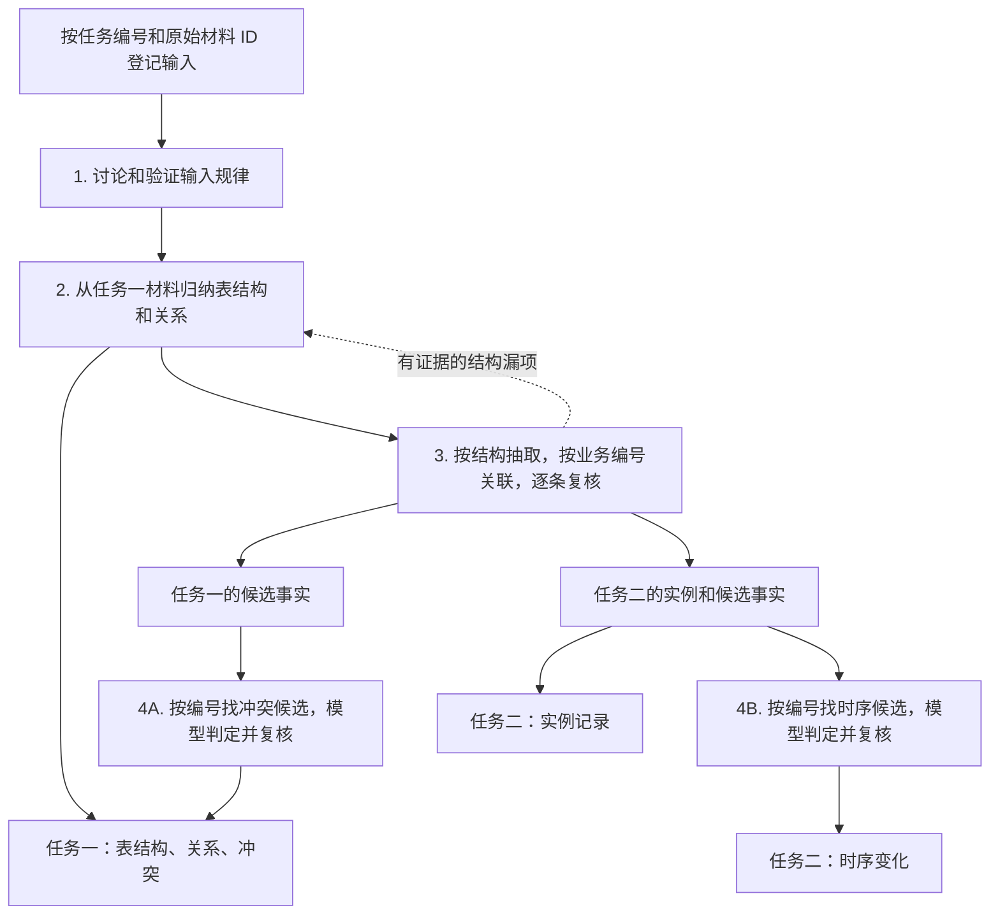

# D01 初赛实施计划

**首轮正式验证目标：用 20 条官方输入生成三份参赛 JSON，并从每条冲突或变化回查原文。** 先用虚构病例检查模型接口和 Docker（比赛运行环境），再用获准处理的官方材料完成首轮试跑，最后扩大到完整验证集。

正式评测同样处理医疗记录，围绕患者关联就诊、检查等对象。程序需要从更多、更丰富的材料中归纳对象和字段。初赛两项任务各 50 分，本计划覆盖表结构、关系、冲突、实例记录和时序变化。

项目约定见 [AGENTS.md](AGENTS.md)，代码分工和验收记录见 [《D01 初赛技术方案》](<D01 初赛技术方案.md>)。提交和评分规则见 [官方答题说明](<D01面向开放数据的领域本体智能化标注技术赛题发布（含答题说明）.pdf>)，字段和标注示例以本地 `验证集/` 为对照。

## 1. 总体流程

**分工：** 大模型负责所有需要理解文本的判断。程序负责分阶段调用、回查原文、校验结果和导出。首轮用编号索引（按编号快速找记录的查找表）沿关系定位候选，模型拿到候选和原文后作出判断。

**设计参考：** [`entity-graph-builder-main`](entity-graph-builder-main/README.md) 提供了三种可借鉴的做法：[用结构校验关系两端的类型](entity-graph-builder-main/entity_extractor/ontology.py)、[核对引文并保存出处](entity-graph-builder-main/entity_extractor/core.py)、[沿关系查找相邻记录](entity-graph-builder-main/entity_extractor/storage.py)。第 3、4 阶段采用这些做法。D01 自行实现结构归纳、对象身份识别、冲突和时序判断，提交程序独立运行。

### 模型运行环境

| 场景 | 接口地址 `LLM_BASE_URL` | 模型 `LLM_MODEL` | 密钥 `LLM_API_KEY` |
| --- | --- | --- | --- |
| 本地开发与验证 | `https://api.siliconflow.cn/v1` | `Qwen/Qwen3.5-27B` | 在启动进程时安全注入硅基流动密钥 |
| 比赛正式评测 | 主办方网关，由容器注入 | 读取主办方注入的模型名 | 读取主办方注入的调用令牌 |

两边共用相同的程序。通过 `scripts/run_siliconflow.sh` 启动本地验证；正式评测从环境变量读取网关和模型。先用不含患者数据的短请求检查接口；已获准将官方验证材料发往硅基流动，可以按第 4 节试跑。换模型后重新跑 20 条试跑材料，新旧模型的成绩分开记录。真实密钥只注入进程环境，提交包只包含运行所需的文件。

## 2. 里程碑与验收

| 顺序 | 开发内容 | 验收条件 |
| --- | --- | --- |
| M0 · 准备 | 核对格式和硅基流动接口，固定试跑清单，写三份输出的格式校验和对照脚本 | 用短请求成功调用硅基流动的指定模型；能校验官方答案的结构；开发评估用的答案单独存放 |
| M1 · 发现与建模 | 实现全量输入讨论、候选目录、结构生成及审核 | 所有输入都有处理记录；对象和字段编码稳定；关系引用有效；模型能解释新增、合并和拆分的依据 |
| M2 · 抽取实例 | 按审核后的结构抽取，按业务编号关联，逐条评分和返工 | 每条已验收事实能回查原文；同名但编号不同的对象保持独立；同一项目可被多次检查引用 |
| M3 · 完成小规模试跑 | 用患者编号索引分别生成冲突和时序候选，模型判定、复核并导出 | 20 条输入产出三份通过格式校验的 JSON；逐组对照第 4 节的预期；两套来源可独立回查 |
| M4 · 验证提分 | 跑完整验证集，对编号筛选、图筛选和审核做对照实验 | 有分项结果、漏项清单、请求数与耗时；只有测得收益的额外步骤进入提交版 |
| M5 · 打包提交 | 验证容器入口和运行参数，整理源码与技术方案 | 在比赛约定环境下从只读输入生成三份结果；提交包不含答案全集、患者日志、外部模型或密钥 |

## 3. 四个阶段怎么实现

### 1）发现规律：全量看，分角色讨论

1. 分别读取两个任务的 `{id, content}` 列表，保留每条材料的原文边界。同一任务内检查 `id` 唯一，内部用「任务编号 + 原始 `id`」定位材料。验证集两份文件各有 200 条文本，其中 168 个 `id` 同时出现在两份文件里，因此同号材料要各自保留。能在一次调用中读完时给模型整批输入；超过上下文容量时分批阅读，再汇总并检查是否覆盖所有来源。
2. 同一个模型分三次调用：先找编号、文档类型和重复模式；再找支持证据和反例；最后归纳可用于分组和排序的规则。每条规则附来源、适用范围和不确定点。
3. 初版用材料 `id` 中的分组规律给候选排优先级。患者编号、就诊号等是原文中的业务编号，用于核对具体是哪条记录；归属不明时由模型结合上下文判断。比较应用分组规律前后的候选覆盖率，再决定是否收窄搜索范围。

**产物：** 分组建议、候选线索、反例和输入覆盖清单。模型给出的规则以结构化数据保存，由程序按预先定义的操作解释执行。

### 2）建立结构：分别抽取对象、属性、关系

1. 以任务一文本为建模依据。给模型官方输出格式、一份药品与医嘱的输入输出示例，以及可扩展的医疗候选表。候选表包括医疗机构、药品、医嘱用药及各自字段。目录中的对象和字段有本批原文支持且通过审核时，正常保留和导出。验证集参考标注可能有遗漏；只能在目录或示例里找到的条目不生成。
2. 先分组提候选对象，汇总同义对象；再按对象提取属性并检查该合并还是拆分；最后识别对象之间如何关联，确定类型编码、字段编码、唯一标识和关系方向。
3. 程序检查编码、数据类型、主键（用来唯一标识一条记录的字段）和外键（用来指向其他记录的字段），再用术语目录统一同义名称及其引用。另一次模型调用根据原文复核对象范围、属性归属和关系含义。修订通过后保存结构版本，下游统一使用同一版本。

**产物：** 审核过的 `object_types`（对象类型）、`link_types`（关系类型）和支持证据。发现字段漏项时，先核对已有字段与同义词，再由模型查看少量引文，判断候选是否缺失、应归到哪张表。程序将经过核实的新字段加入表结构，再按定稿结构抽取记录。

### 3）抽取记录：先找全，再逐条验收

1. 按患者或就诊上下文定位同组文本里的记录，再把第 2 阶段审核过的对象、字段和关系约束交给模型逐条抽取。程序检查字段类型、关系两端允许的对象类型、连接字段及其目标记录。
2. **按业务编号识别对象。** 各任务内使用「对象类型 + 该类型的主键值」标识记录，例如患者编号、就诊编号、检查项目编号、检查记录编号。同名记录先核对编号。缺少编号或归属不明时交给模型结合原文判断，仍无法确认的保留为候选。多条检查记录可指向同一检查项目，每条检查记录保留自己的编号、时间和结果。结构新增对象类型时，使用该类型经审核的主键。
3. **按事实保留原文。** 字段值和关系都要记录所属对象、字段或关系、原始取值及可确认的时间，并关联一段或多段证据。每段证据保存任务编号、原始材料 `id` 和原文引句；程序按来源核对引文。规范化后的值或日期单独保存。同一字段的不同取值，以及暂时无法归到字段的证据，保留到第 4 阶段。
4. 用同一个模型独立评分，逐项核对字段、对象身份、引用和证据，同时检查漏提。关键字段有原文支持、身份与关系正确、必需信息齐全、程序校验通过后，记录才算验收。首次不通过可按具体意见返工一次；仍不通过就登记问题和影响范围。任务一的事实供冲突比较，任务二的事实供实例导出和时序比较。

**产物：** 已审核的实例、可按来源回查的候选事实、未通过记录和返工原因。先完成任务一抽取及结构漏项复核，再用定稿的结构抽取任务二。单独运行任务二时保留同样的建模步骤，只导出任务二文件。

### 4）分析冲突与时序：先定位候选，再核对语义

1. 两个任务分别建编号索引，按结构定义的关系，从患者沿「就诊 → 检查记录 → 检查项目」等路径查找相关事实。共享检查项目可以服务多名患者，候选始终保留各自的患者归属。首轮用编号索引和现有关联完成查找；更复杂的图查询、向量库和额外模型接口留待实测发现需求后再评估。
2. **冲突候选来自任务一。** 已有字段的冲突使用「对象编码.字段编码」选项定位归属。无法归入现有字段的冲突单独判断，属性编码留空。确认两份原文互斥后，逐份检查同组材料，找出能独立支持其中一方的证据；模型再次确认互斥后，分别生成证据配对。
3. **时序候选来自任务二。** 按同一患者、同一比较维度和变化项分组。模型给出状态、时间及两者的逐字证据，程序核对后导出 `values`（状态序列）。程序给相邻报告对编号，模型逐对判断有无等价表述并提供引文。程序按报告对填写来源和时间，写入 `statusPairs`（伪变化对）。
4. 每个子步骤独立复核身份、时间、语义和证据。对于首次复核驳回的未创建冲突和伪变化，模型可逐条独立核实原文。导出前按「任务编号 + 原始 `id`」核对来源，输出 `source_id`、`ref` 时填写原始 `id`。检查属性编码、关系目标、文件名和字段名是否符合比赛约定。

**产物：** `/output/task1/labels.json`、`/output/task2/labels-t1.json`、`/output/task2/labels-t2.json`。中间事实和审核记录单独保存，以便定位漏项发生在哪一步。

## 4. 首轮试跑：20 条官方输入

按下表选完整文本组。选组编号只写进本地试跑清单。模型输入只包含原文、当阶段所需的上下文和独立示例；预期结果留给评估脚本和人工核查。

| 输入 | 文本组 | 条数 | 验收重点 |
| --- | --- | ---: | --- |
| 任务一 | `M000600` | 2 | 正常记录，能找出对象、字段和关系，不额外报冲突 |
| 任务一 | `M000589` | 4 | 一条已创建的检查结果冲突，来源和字段正确 |
| 任务一 | `M000703` | 5 | 两条未创建的冲突，属性编码留空，保留对应证据 |
| 任务二 | `M000003` | 2 | 能形成正常实例并连接记录，不额外报时序变化 |
| 任务二 | `M000233` | 3 | 提取一组真实变化，正确绑定患者、比较项、时间和原文 |
| 任务二 | `M000235` | 4 | 提取含三个时间点的一组状态序列，以及一对伪变化 |
| **合计** | **6 组** | **20** | **三份文件通过格式与引用校验，再逐组核对内容** |

试跑同步检查最初的分组、表结构、逐条评分和图中的候选。小样本的表结构只按这批原文覆盖的范围验收。完整验证集里留出 `M000234` 等未参与试跑和示例的记录组，分开记录结果。时序标准答案总共只有三组，留出成绩用来检查具体错误，暂不据此判断正式评测表现。

用完整官方验证集做两项本地检查，无需调用模型：从两个输入文件选一个共同的 `id`，确认两条来源能分别回查；从任务二答案挑一个被多条检查记录引用的项目，确认这些记录可以指向同一项目，每次检查仍能按自己的编号单独读取，不同患者的记录分在各自的时序候选中。

## 5. 怎么判断改动有用

先固定一版完整工作流作为对照。每次仅调整一个环节，在相同输入上比较。用 `check_answers.py` 将三份输出与本次运行记录配对，再用 `compare_experiments.py` 核对输入、标准答案、代码版本和模型配置，并汇总分项差异。

| 改动 | 对照开关 | 主要看什么 |
| --- | --- | --- |
| 材料初分组 | `--record-group-mode single`：逐份材料定位 | 是否影响跨来源关联、记录覆盖和调用量 |
| 患者编号索引 | `--candidate-mode grouped`：比较时仅用材料初分组 | 冲突和时序的证据是否仍在同一个候选窗口 |
| 长组关联证据 | `--comparison-window-mode sequential`：长组只按原始顺序切分 | 同一对象的分散证据能否一起送到模型，额外窗口增加多少调用 |
| 模型评分、返工与复核 | 分别用 `--skip-record-review`、`--skip-comparison-review` | 保留程序校验，用同一首次结果比较改对、改错和漏项数量 |
| 医疗候选表和示例 | 分别用 `--omit-medical-catalog`、`--omit-schema-example` | 对照留出组的字段覆盖，并用与建模示例不同的对象检查扩展能力 |

本地分别计算对象、属性、关系、冲突、实例和时序相对参考标注的查准率、查全率及 F1（综合考虑两者的分数）。报告列出参考标注未覆盖的目录对象、字段及相关关联，按原文证据和审核结论确认是否为合理扩展。实例既算原始匹配，也算内部编号对齐后的匹配；对齐要求业务身份唯一，原文明确给出的编号保留原样。20 条试跑按六组报告；完整验证另列留出组和跨组条目。结合运行日志检查校验失败、无证据条目、候选漏项、模型请求数和运行时间。官方部分文本采用语义匹配，阈值和各子项权重未在手头材料中给出；本地分项结果用于选方案和排查，最终以官方评测为准。

各阶段共用一套限速。本地按硅基流动账号和模型的实际限额设置，正式评测遵守每队每分钟最多 120 次请求的规则。记录定位、抽取和候选比较各自限制同时进行的任务数，收到鉴权或计费错误后停止发起新的请求。完整验证集有 333 条任务二标准实例，仅按每条一次抽取、一次审核估算就有 666 次调用，另有定位、复审、冲突和时序调用。先从试跑测得各阶段的实际请求量和耗时，再确定并发与返工成本。中间产物按输入、结构和模型提示版本保存，局部变更只重跑受影响的部分。

## 6. 提交前检查

- [x] 已用 `Qwen/Qwen3.8-27B` 验证硅基流动接口；虚构病例通过三份输出的格式与引用校验。
- [x] 20 条官方材料已完成小样本试跑；生成 15 条实例和 15 条实例关联，3 条冲突的来源、5 个时序状态和 1 对伪变化的证据匹配。详见 [《D01 初赛技术方案》](<D01 初赛技术方案.md>)。
- [x] 小样本结构已通过离线核对：4 类对象、17 个标准属性和 3 类关系匹配；编号对齐后，13/15 条完整实例和 14/15 条关联匹配。
- [x] 用 `Qwen/Qwen3.5-27B` 完成硅基流动真实接口检查，请求不含医疗数据。
- [x] 用 `Qwen/Qwen3.5-27B` 跑通 20 条官方材料，三份文件通过格式与引用校验。
- [x] 完成 `Qwen/Qwen3.5-27B` 小样本验收：输出 14 条实例关联，3 条冲突的来源组合、5 个按天核对的时序状态和 1 对伪变化匹配参考标注。实例漏项留作完整验证的分项检查。
- [ ] 使用主办方允许的运行环境，核对注入的网关配置及结构化输出。
- [x] 任务二已完成 200 条材料的全量验证，已核对留出组、字段覆盖和跨来源证据。分项成绩已写入技术方案。
- [ ] 完成任务一全量冲突验证，核对留出组和跨来源证据，并将成绩补入技术方案。
- [x] 本地容器曾用只读 `/input` 和独立输出目录完成虚构病例验收；单任务模式与 `all` 的对应结果一致。
- [x] `0.1.2` 验证包通过完整性检查，并从 Ubuntu 22.04 基础镜像成功构建。用 20 条材料的真实响应缓存核对了任务一导出和任务二中断留档。
- [x] `0.1.6` 验证包按 Ubuntu 22.04、`linux/amd64` 构建。20 条材料从只读 `/input` 读入，`task1`、`task2` 和 `all` 均完成；单任务输出与 `all` 的对应文件逐字节一致。
- [x] `0.1.7` 验证包已完成 20 条材料的容器验收。三个入口的对应文件逐字节一致，并与本地试跑输出一致。[本地验收包](dist/d01-local-check_code_0.1.7.zip)
- [ ] 用正式队名生成提交包。
- [x] 已用官方实例与真实运行记录验证问题清单：关联目标缺失时可回查原始材料，审核不通过时可定位审核条目；输入错误和缓存中断均记录失败阶段。
