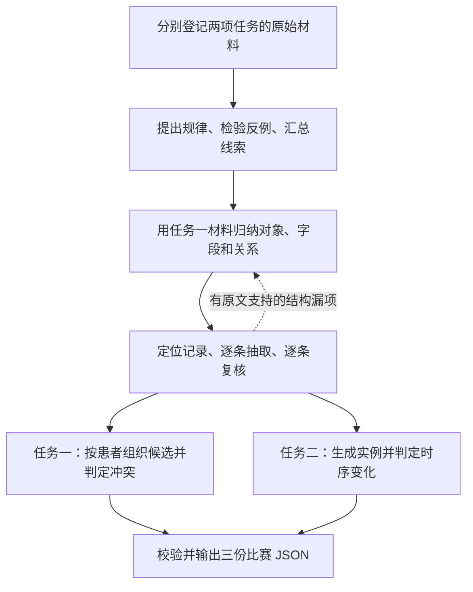

# D01 初赛技术方案

程序从任务一材料归纳表结构和关系，再用同一套结构整理两项任务的记录。每条事实保留原文出处。程序沿患者、就诊及其他对象的关联收集材料，大模型判断哪些说法互相冲突、哪些状态随时间发生变化。

## 1. 工作流

| 阶段 | 大模型负责 | 程序负责 | 代码 |
| --- | --- | --- | --- |
| 发现规律 | 提出分组假设、查找反例、汇总线索 | 统计材料覆盖，核对引文，执行有限的编号分段规则 | [discovery.py](src/d01/discovery.py) |
| 归纳表结构 | 找对象、逐类定字段、识别关系、独立复核 | 校验结构和引用，统一常见术语的名称与编码，保存审核后的版本 | [schema_stage.py](src/d01/schema_stage.py)、[vocabulary.py](src/d01/vocabulary.py) |
| 抽取记录 | 定位对象、逐条取值、判断归属并复核 | 核对字段类型、引文和关联目标，按业务编号连成图 | [records.py](src/d01/records.py)、[graph.py](src/d01/graph.py) |
| 比较和导出 | 判定冲突、真实变化和伪变化，独立复核 | 按患者组织候选、校验时间和引用、导出比赛文件 | [comparison.py](src/d01/comparison.py)、[workspace.py](src/d01/workspace.py) |

建模时给模型比赛格式、医疗候选目录，以及一份药品与医嘱的独立示例。目录中的医疗机构、药品、医嘱用药等对象和字段，有本批原文支持并通过审核时，正常保留和导出。验证集的参考标注可能有遗漏，仅用于本地对照。记录审核要求标记通过、评分至少 90，且问题列表为空。记录和比较结论各允许返工一次，仍未通过的项目进入运行记录，供下一轮排查。

当已审核的记录提议新增字段时，程序先查同一张表里是否已有该字段或目录同义词。其余候选逐项交模型核对，最多给三份来源的原文节选。模型根据原文确定字段含义、所属表和是否缺失。程序核对新增字段的引文、编码和归属，将复核结论存入 `schema-feedback.json`。

## 2. 三个关键设计

**材料编号和业务编号分开。** 同一个材料 `id` 可能在两项任务里出现，程序查原文时先找对应任务，再查 `id`。跨记录关联使用原文里的患者编号、就诊号、检查记录号等业务标识。患者同名时，优先用有原文依据的编号或证件号核实身份。

分组前，程序按材料编号的常见分隔符列出几种切法，再让模型对照每种切法的示例组和原文。这样可以区分表示患者材料组的编号与表示首页、报告等文档角色的编号。抽取一条记录时，程序按已审核的表结构列出可关联的目标，模型选择有证据的选项，程序填入双方的字段和记录编号。

**检查项目可以共享，检查记录分别保存。** 检查项目表示「做的是什么检查」；检查记录表示「哪位患者在哪次就诊做了什么检查，结果如何」。同一个项目可连接多名患者。查找检查记录归属时，程序沿就诊关系找患者，在共享项目处停止，避免把其他患者的记录带入比较。

**各类判断分别复核。** 已创建冲突先选「对象编码.字段编码」，程序按同一选项填入对象和字段。未创建冲突可逐份查找同组的独立补充证据。时序状态的日期和取值都要绑定原文。伪变化按相邻报告对单独判断和复核，一对未通过时保留其他报告对的结果。未创建冲突和伪变化出现复核争议时，模型独立判断并引用两侧原文。合并各窗口的状态后，再核对两条报告是否仍然相邻。

长组切分时，先保留按原始顺序划分的窗口，再将同一对象或同一检查项目的相关字段补到同一窗口。存在明确日期时，任务二的关联证据按时间排列。每个窗口只发送能在其中回查的引文。

## 3. 验证结果

### Qwen3.5 任务二全量

2026 年 11 月 20 日，`Qwen/Qwen3.5-27B` 完成任务二的 200 条验证材料。两份输出均通过格式和引用校验，共导出 386 条实例、456 条关联和 3 组时序。候选窗口覆盖了参考标注中的全部 4 对相邻时序及 1 对伪变化。按日期、来源和取值核对，7 个时序状态全部匹配。严格核对时有 3 个状态因为输出保留了原文的时分而产生差异。

| 本地对照项目 | 程序输出 | 参考标注 | 匹配 | F1 |
| --- | ---: | ---: | ---: | ---: |
| 完整实例（对齐内部编号后） | 386 | 333 | 95 | 26.4% |
| 实例字段（对齐内部编号后） | 1762 | 1406 | 1029 | 65.0% |
| 实例关联（对齐内部编号后） | 456 | 304 | 185 | 48.7% |
| 时序状态（严格匹配） | 7 | 7 | 4 | 57.1% |
| 伪变化 | 1 | 1 | 1 | 100% |

待排查项集中在实例和关联，35 条候选记录复核未通过，20 条关联未能确定目标。严格对照时，编号直接匹配的完整实例和实例关联均为 0。按业务身份核对时，97 条就诊、92 条患者和 93 条检查记录可与参考标注唯一对应。程序将机构单独建表，保留了 16 条机构实例和 97 条就诊到机构的关联。沿关联取回机构名称后，97 条就诊的机构名称均与参考标注一致。

191 条留出材料的实例字段、实例关联 F1 分别为 64.9% 和 48.4%，2 个时序状态按日期、来源和取值核对均匹配。本轮包含任务一的建模和漏项复核。任务一的全量冲突结果待验证。 [任务二评分报告](.runs/qwen35/full-task2-resume/report.json) · [问题清单](.runs/qwen35/full-task2-resume/work/73309b357d15/issues.json)

### Qwen3.5 小样本

2026 年 11 月 19 日，使用硅基流动的 `Qwen/Qwen3.5-27B` 完成同一批 20 条官方材料的试跑，三份文件均通过格式与引用校验。输出保留了医疗机构表和 3 条机构实例：3 个机构名称均能在原文查到，3 条就诊记录已关联到机构。验证报告将医疗机构单列为目录扩展项。

| 项目 | 程序输出 | 参考标注数量 | 严格命中 |
| --- | ---: | ---: | ---: |
| 对象类型 | 5 | 4 | 4 |
| 字段 | 24 | 17 | 16 |
| 关系类型 | 4 | 3 | 3 |
| 实例 | 16 | 15 | 10（对齐内部编号后） |
| 实例关联 | 14 | 15 | 11（对齐内部编号后） |
| 冲突 | 3 | 3 | 2 |
| 时序状态 | 5 | 5 | 3 |
| 伪变化 | 1 | 1 | 1 |

程序送给模型的候选窗口覆盖了全部 3 组参考冲突、3 对相邻时序和 1 对参考伪变化。3 条冲突来源组合全部匹配，其中 1 条取值写法不同。两组时序的 5 个状态按天核对均匹配；严格分数中的两处差异来自保留原文的时分。验收轮复用了 148 条真实响应，新增 4 次请求，耗时约 39 秒。

同批材料只关闭比较复核时，三份输出逐字节一致。模型调用次数（新请求与缓存命中之和）从 152 降到 138。复核是否保留，需结合完整验证集留出组的漏项和误报判断。

扩充目录前的基线导出 7 条实例，实例关联、冲突和时序均为 0；候选窗口覆盖 0/3 组参考冲突、1/3 对相邻时序。基线使用 163 次新请求和 14 次缓存，耗时约 13 分 56 秒。两轮的缓存量不同。

以下两轮使用 `Qwen/Qwen3.8-27B`。

### 术语和实例复验

同一批 20 条材料的建模与实例抽取已完成。离线核对使用本次审核后的记录，未发起新请求。

| 项目 | 首版严格命中 | 本轮严格命中 | 本轮对齐内部编号后 |
| --- | ---: | ---: | ---: |
| 对象类型 | 2 / 4 | 4 / 4 | — |
| 属性 | 5 / 17 | 17 / 17，另输出 1 个字段 | — |
| 关系类型 | 0 / 3 | 3 / 3 | — |
| 完整实例 | 0 / 15 | 0 / 15 | 13 / 15 |
| 实例字段 | 21 / 66 | 45 / 66 | 62 / 66 |
| 实例关联 | 0 / 15 | 0 / 15 | 14 / 15 |

15 条实例均能按业务信息唯一对应；对应记录中的非编号字段均匹配。接口在任务二伪变化阶段返回 `HTTP 402`。随后用同一批响应离线生成并核对了任务一：输出 4 条冲突，其中 3 条的来源组合与标准答案匹配，2 条严格匹配。下方是较早一轮完整试跑的结果。

### 20 条官方材料

使用硅基流动的 `Qwen/Qwen3.8-27B`，处理六组官方材料。三份输出均通过格式与引用校验。候选窗口覆盖了全部 3 组冲突证据和全部 3 对相邻时序证据。容器用只读输入、断网和真实响应缓存重放，三份输出与本地逐字节一致。

| 项目 | 输出 / 标准答案 | 证据命中 | 本地严格匹配 |
| --- | ---: | ---: | ---: |
| 对象类型 | 4 / 4 | — | 2 / 4 |
| 属性 | 19 / 17 | — | 5 / 17 |
| 关系类型 | 3 / 3 | — | 0 / 3 |
| 冲突 | 3 / 3 | 3 / 3 组来源 | 2 / 3 |
| 实例 | 15 / 15 | — | 0 / 15 |
| 实例关联 | 15 / 15 | — | 0 / 15 |
| 时序状态 | 5 / 5 | 5 / 5 个主体、来源、日期和取值 | 0 / 5 |
| 伪变化 | 1 / 1 | 1 / 1 对原文短语和时间 | 0 / 1 |

严格匹配按本地脚本的规范化精确比较统计。时序证据已对齐，严格匹配受字段标题差异影响；第 3 条冲突的来源正确，取值与标准答案有出入。实例和关联仍需核对对象名称、字段和业务编号。首轮从空缓存开始用了 88 次请求，耗时 707.98 秒；本轮复用 117 次缓存，新增 6 次请求，耗时 19.86 秒。两次各自记录调用量和耗时，不用缓存重放估计正式运行速度。

### 基础检查

| 检查 | 样本 | 结果 |
| --- | --- | --- |
| 官方答案格式和引用 | 两项任务共 400 条材料 | 333 条标准实例、10 条标准冲突、3 组标准时序通过校验；168 个跨任务重复的材料编号可独立回查 |
| 本地评分工具 | 对照官方答案，批量替换患者内部编号及其引用 | 98 个患者编号准确对齐，16 组歧义保持原样；首轮报告覆盖 6 组，留出部分包含任务一 189 条、任务二 191 条 |
| 记录图归属 | 官方任务二标准实例 | 103 条检查记录各归属一个患者和一个项目；27 个项目由多名患者共享；找到 3 个患者在同一项目上有多次检查的分组 |
| 容器端到端 | 9 条虚构材料，Ubuntu 22.04、`linux/amd64`（比赛的系统和处理器架构） | `all` 模式产出 4 类对象、3 类关系、6 条实例、1 条冲突、1 组含 3 个时间点的状态序列及 1 对伪变化；三份输出通过格式与引用校验 |
| `0.1.7` 验证包 | 20 条官方材料，Ubuntu 22.04、`linux/amd64`，只读 `/input` | `task1`、`task2` 和 `all` 均完成。单任务输出与 `all` 的对应文件逐字节一致，`all` 的三份输出与本地试跑逐字节一致 |
| `0.1.6` 验证包 | 20 条官方材料，Ubuntu 22.04、`linux/amd64`，只读 `/input` | `task1`、`task2`、`all` 均完成，各自只写约定文件。对应文件与本地试跑逐字节一致。使用硅基流动真实响应，`all` 复用 151 条缓存并发出 1 次新请求 |
| 单任务入口 | 同一批虚构材料，复用真实模型的缓存响应 | 三种模式的定稿结构一致；`task1` 和 `task2` 各自只写本任务文件，内容与 `all` 中对应文件一致 |
| 比较复核对照 | 同一批虚构材料，两轮均复用真实模型响应 | 开启时命中缓存 53 次，关闭时命中 50 次，三份输出一致；对照工具能拒绝错配的输入和没有改变开关的两轮 |
| 长组候选覆盖 | 重排虚构病例的 3 个时间点并缩小窗口，用已审核模型抽取结果 | 只按顺序切分时，2 对相邻证据中有 1 对同窗；补充 1 个关联窗口后，两对均同窗 |
| 上一版代码压缩包 | 解压后将入口和源码挂载到已有比赛环境镜像 | 20 条官方材料的三份输出与本地逐字节一致 |
| `0.1.2` 验证包 | 解压后用 Ubuntu 22.04 基础镜像构建 `linux/amd64` 容器 | 依赖检查通过；包内包含运行文件和独立的评测说明 |
| `0.1.2` 容器离线重放 | 只读 `/input`，断网，使用 20 条官方材料的历史真实响应 | `task1` 复用 76 条响应，输出与本地逐字节一致。`task2` 和 `all` 在缺少伪变化响应时停止，保留已校验结果及其指纹；两个正式输出目录均未写入文件 |
| 问题清单 | 官方实例和历史模型审核记录 | 移除一条就诊后，清单能列出关联缺失的检查记录及来源；未通过的时序可定位审核条目。重放的任务一输出与 `0.1.2` 一致 |
| 并发停止 | 硅基流动真实接口，12 项不含医疗数据的探测任务，最多 4 项并发 | 首个请求返回 `HTTP 402`，实际只发送 1 次。另用 20 条材料的历史响应重放，任务一输出与 `0.1.3` 逐字节一致 |

虚构材料的容器全流程耗时 79.76 秒，包含 25 次新请求和 28 次缓存命中。

## 4. 复现与提交

本地运行、对照开关和打包方法见 [README.md](README.md)。每次运行保存实验设置、输入输出指纹（用来确认文件内容没变的校验值）和请求统计。`issues.json` 汇总未通过的记录和比较、未解决的关联及无法确认的实例取值。运行中断时，可从 `summary.json` 定位阶段，再用问题清单和审核文件查看对应材料。评分报告按材料编号列出冲突、时序和伪变化的漏项与多报项。

本地验收包使用临时队名 `d01-local-check`，版本为 `0.1.7`。正式包使用登记的队名，技术方案单独提交。[本地验收包](dist/d01-local-check_code_0.1.7.zip)

完整验证按 [《D01 初赛实施计划》](<D01 初赛实施计划.md>) 执行。先在小样本检查关联、冲突和时序的覆盖，再用完整验证集检查留出组。一次只改一个实验开关，分别记录分项查准率、查全率和 F1（两者的综合分数），以及候选覆盖、请求数和耗时。参考标注未覆盖的目录扩展项单列，回查原文后判断。正式容器读取主办方注入的模型配置，从只读 `/input` 读数据，把三份文件写到 `--out-dir`。本地容器已通过小样本验收，完整验证集与主办方网关测试单独记录。
